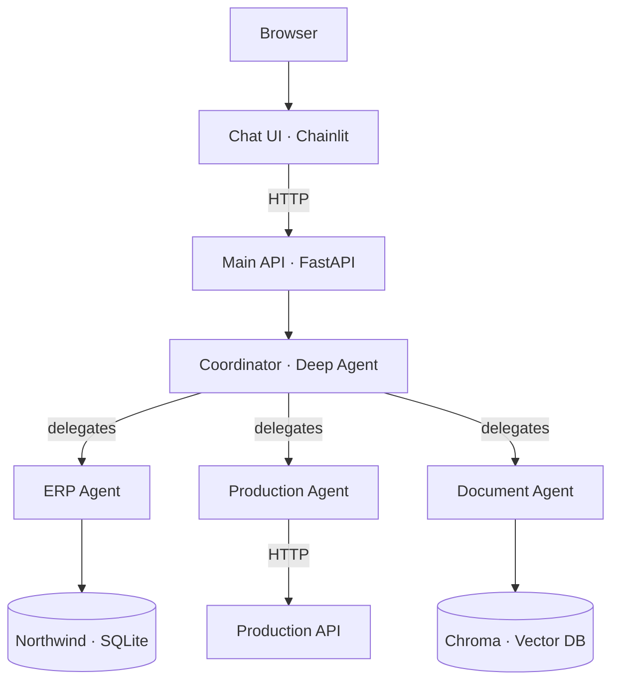

# Multi-Agent Enterprise Business Assistant

Answers natural language business questions by orchestrating data across three distinct sources:

| Source         | Business Context                              | Integration Method          |
| -------------- | --------------------------------------------- | --------------------------- |
| **ERP**        | Clients, orders, and financial amounts        | Northwind Database (SQLite) |
| **Production** | Manufacturing status, bottlenecks, and delays | REST API                    |
| **Documents**  | Contracts, SLAs, and PDF procedures           | RAG over a Vector Database  |

A Coordinator Agent, built with **LangChain Deep Agents**, plans the execution, delegates tasks to source-specific specialized agents, and synthesizes a final response. Every answer explicitly details **which sources were queried and the exact execution steps taken**.

---

## Quickstart & Deployment

You only need Docker (with Compose v2) and an API key for OpenAI, Azure OpenAI or Anthropic.

**1. Configure the model**

```bash
cp .env.example .env
```

Open `.env` and fill in the block for your provider:

```env
# OpenAI
MODEL=openai:gpt-5.6-luna
OPENAI_API_KEY=your-api-key
```

```env
# Azure OpenAI
MODEL=azure_openai:gpt-5.6-luna
AZURE_OPENAI_API_KEY=your-api-key
AZURE_OPENAI_BASE_URL=https://your-resource.openai.azure.com/
AZURE_OPENAI_API_VERSION=2024-12-01-preview
AZURE_OPENAI_MODEL_DEPLOYMENT_NAME=gpt-5.6-luna
```

**2. Boot up the system**

```bash
docker compose up --build
```

The initial startup takes a few minutes. During boot, the system automatically provisions the ERP data, the mock production data, and pre-indexes two sample PDFs into the vector store.

**3. Start using it**

| Service                         | URL                        |
| ------------------------------- | -------------------------- |
| **Chat UI**                     | http://localhost:8080      |
| **Main API** (Interactive docs) | http://localhost:8000/docs |
| Mock Production API             | http://localhost:8001/docs |

To check that the model is reachable before asking anything (takes a few seconds and reports the exact error if a key, endpoint or API version is wrong):

```bash
docker compose run --rm cli python scripts/check_model.py
```

To see what is stored in each data source (ERP tables, production states, indexed chunks), without any LLM:

```bash
docker compose run --rm cli python scripts/inspect_data.py erp
docker compose run --rm cli python scripts/inspect_data.py chroma
docker compose run --rm cli python scripts/inspect_data.py search "late delivery penalty"
```

To stop the system: run `docker compose down` (add `-v` to wipe generated data and volumes).

---

## Observability with Langfuse (optional)

Every answer already carries its own trace (`sources`, `reasoning`, `steps`). For a deeper, operator-level view, the system can also send each query to a self-hosted [Langfuse](https://langfuse.com) instance: every LLM call and tool call, nested by agent, with inputs, outputs, token usage and latency, grouped by conversation.

```bash
docker compose -f docker-compose.yml -f docker-compose.langfuse.yml up -d --build
```

| Service           | URL                   | Login                                  |
| ----------------- | --------------------- | -------------------------------------- |
| **Langfuse UI**   | http://localhost:3000 | `admin@example.com` / `langfuse-local` |

To avoid repeating both `-f` flags on every command, uncomment the `COMPOSE_FILE` line in `.env`: from then on, `docker compose up -d` brings everything up.

No manual setup is required: the user, the project and its API keys are created on first boot (headless initialization), and the app picks up the same keys. Langfuse needs a few extra minutes and around 4 GB of RAM on first start.

Tracing is switched on only when `LANGFUSE_PUBLIC_KEY` and `LANGFUSE_SECRET_KEY` are set. Without them, or if Langfuse is unreachable, queries work exactly the same. The passwords in `docker-compose.langfuse.yml` are meant for local use; change every line marked `CHANGEME` before exposing it.

---

## Usage Examples

### Via Chat Interface

Open http://localhost:8080 and start asking questions. Example queries:

- _What pending orders does the client Ernst Handel have, and what is their current production status?_
- _Which orders are currently blocked and what is the underlying reason?_
- _Which clients have delayed orders due to production bottlenecks?_
- _Give me a summary of the status of all orders placed this month._
- _Are there any financial penalties for delivery delays mentioned in the contract?_

The system supports follow-up conversational queries (_"and which of those are blocked?"_, _"what is the financial impact of those?"_). To query a document, simply attach a PDF using the paperclip icon.

### Via REST API

```bash
curl -X POST http://localhost:8000/api/query \
  -H "Content-Type: application/json" \
  -d '{"question": "Which orders are blocked and what is the reason?", "session_id": "demo"}'
```

The response consistently follows this schema:

```json
{
  "answer": "Final response synthesized by the LLM based on retrieved context.",
  "sources": ["Production", "ERP"],
  "reasoning": [
    "Plan: (1) Ask the Production API for blocked orders; (2) Ask the ERP for the client tied to each order.",
    "Coordinator: delegates to the Production Agent → «...»",
    "Production Agent: queries production API for orders in 'blocked' state → 5 found (...)",
    "Coordinator: delegates to the ERP Agent → «...»",
    "ERP Agent: queries ERP for client and amount details for the retrieved orders [...] → 5 clients found...",
    "Coordinator: synthesizes results from Production and ERP to draft the final response."
  ],
  "session_id": "demo"
}
```

It also includes a `steps` array (detailed logging of each tool invocation) and `duration_ms`. The `session_id` is optional: passing the same value allows the system to remember the conversation context.

To upload a document via API:

```bash
curl -X POST http://localhost:8000/api/documents -F "file=@contract.pdf"
```

---

## System Architecture



**Query Execution Flow**

1. The **Coordinator** formulates a plan and distributes the workload. It has _no direct access_ to any data; its sole responsibility is delegation.
2. Each **Specialized Agent** receives a task, utilizes its specific tools, and returns a concise summary.
3. The Coordinator **cross-references the results** (e.g., joining ERP and Production data via Order IDs) and drafts the final user-facing response.
4. Concurrently, the system **audits every tool invocation**. The `sources` and `reasoning` outputs are generated deterministically from these logs.

**Codebase Organization**

| Directory                       | Responsibility                                                        |
| ------------------------------- | --------------------------------------------------------------------- |
| `app/data_sources/`, `app/rag/` | Infrastructure layer: SQL execution, HTTP requests, and Vector Search |
| `app/tools/`                    | Tool implementations exposed to the agents                            |
| `app/agents/`                   | Prompts, agent definitions (Coordinator & sub-agents), and memory     |
| `app/services/`                 | Query execution logic and traceability builders                       |
| `app/api/`                      | FastAPI endpoints                                                     |
| `ui/`                           | Chainlit Chat Interface                                               |
| `production_api/`               | Simulated Production Microservice (standalone app)                    |

Adding a new data source simply requires writing its specific tools and registering a new sub-agent in `app/agents/subagents.py`. The core orchestration logic remains untouched.

---

## Architecture & Engineering Decisions

**Deterministic, Code-Driven Traceability.**
`sources` and `reasoning` are built directly from actual tool execution logs, not generated by the LLM. A source is only cited if a successful query was made, and each step includes the raw data retrieved. The model cannot hallucinate tool executions. All actions are securely logged.

**Strict Agent Boundaries (Zero Data Access for Coordinator).**
The Coordinator strictly plans and delegates. It cannot query databases directly. This enforces a true multi-agent topology and keeps the context window for each agent small, focused, and efficient.

**No LLM-Generated SQL (Security First).**
To guarantee predictability and eliminate SQL injection vectors, the LLM is strictly prohibited from writing raw SQL. ERP queries are routed through predefined, parameterized endpoints, and the database connection is strictly read-only.

**Decoupled Microservice Architecture.**
Because production data wasn't natively provided, it is simulated as an isolated REST API. The main application queries it strictly over HTTP, mirroring real-world enterprise architectures and enabling independent manual validation of the responses.

**Dynamic Date Shifting for Realism.**
The original Northwind dataset dates back to 1996-1998, meaning queries like "this month's orders" would fail. On boot, the system dynamically shifts all database dates forward so the latest order aligns with today, preserving all logical delivery timelines and delays.

**Data Privacy First (Local Embeddings).**
Vector embeddings are computed using a fast, local model. Document contents never leave the host machine during the embedding process, eliminating API costs and ensuring privacy. Only strictly retrieved chunks are sent to the LLM provider for the final synthesis.

**Strict RAG Citations.**
Every retrieved text chunk stores its source document and page number. If the retrieved context is irrelevant, the system is instructed to explicitly state that the documents do not contain the answer, effectively preventing hallucinations.

**Bounded Execution.**
Each agent has a cap on tool calls per query (`AGENT_MAX_TOOL_CALLS`, default 10 per sub-agent task; `COORDINATOR_MAX_TOOL_CALLS`, default 8) enforced with LangChain's call-limit middleware. Past the cap, tool calls are no longer executed and the agent answers with what it has, so an overly broad question cannot spiral into minutes of calls. Broad questions are served by aggregate tools (e.g. all customers with their order counts in a single query) instead of one call per entity.

**Session-Based Memory.**
State is maintained via `session_id`. The LLM is provided with the current query and the rolling window of the last five interactions to maintain conversational context.

**LLM Provider Agnosticism.**
The core logic is decoupled from the underlying LLM. Providers (OpenAI, Azure OpenAI, Anthropic, Ollama) can be swapped instantly by changing the `MODEL` environment variable, requiring zero code modifications. Temperature is only sent when `MODEL_TEMPERATURE` is set, since reasoning models such as GPT-5.6 Luna use their own.

**Two Levels of Traceability.**
The response-level trace (`sources`, `reasoning`) is built by the application and is always present, so it can be shown to the end user. Langfuse is an optional, operator-level layer for debugging and monitoring. It plugs in as a LangChain callback, so it is disabled with no code changes and never affects whether a query succeeds.

---

## Testing

```bash
docker compose run --rm --build tests
```

The test suite contains 102 unit and integration tests that **do not require an API key**. Agent behaviors are tested against a mocked LLM that follows a predefined script, verifying that delegation, tooling, traceability, memory, model configuration, Langfuse integration and API layers function flawlessly under real-code conditions.

---

## Dependencies

Built with Python 3.12. All dependencies are strictly pinned in `pyproject.toml` and `uv.lock`.

| Category               | Libraries                                                            |
| ---------------------- | -------------------------------------------------------------------- |
| Agents & Orchestration | `deepagents`, `langchain`, `langgraph`                               |
| LLM Integrations       | `langchain-openai`, `langchain-anthropic`, `langchain-ollama`        |
| RAG & Vector DB        | `langchain-chroma`, `fastembed`, `langchain-text-splitters`, `pypdf` |
| API Layer              | `fastapi`, `uvicorn`, `httpx`                                        |
| User Interface         | `chainlit`                                                           |
| Observability          | `langfuse`                                                           |
| Testing                | `pytest`                                                             |

---

## Known Limitations

- **Volatile Memory:** Conversation memory is cleared upon API restart. This can be resolved by swapping the in-memory store for a persistent cache (e.g., Redis).
- **Missing Authentication:** The API is unauthenticated. In a production environment, this would require a gateway/auth layer and tenant-isolated document storage.
- **Basic Search Capabilities:** The embedded model is lightweight. Highly semantic queries that deviate significantly from the document's vocabulary might miss exact chunks.
- **No OCR Support:** Scanned PDFs without a text layer are currently rejected with a warning.

---

## Data Acknowledgements

- **Northwind**: SQLite port by [jpwhite3/northwind-SQLite3](https://github.com/jpwhite3/northwind-SQLite3) (MIT License).
- Production data and the PDFs inside `data/docs/` are **fictitious assets** generated exclusively for this technical demonstration.
