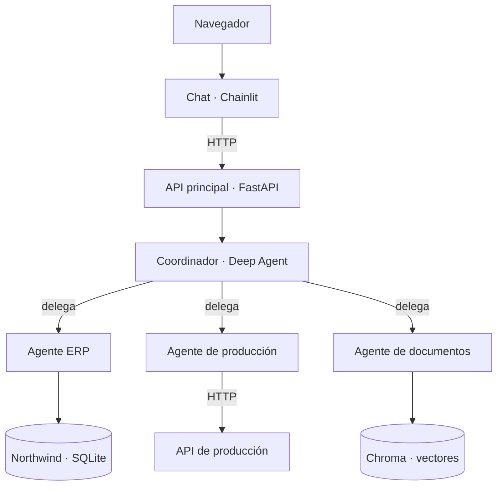

# Asistente de negocio multi-agente

Responde preguntas de negocio en lenguaje natural combinando tres fuentes de datos:

| Fuente | Qué aporta | Cómo se consulta |
|---|---|---|
| **ERP** | Clientes, pedidos e importes | Base de datos Northwind (SQLite) |
| **Producción** | Estado de fabricación, bloqueos y retrasos | API REST |
| **Documentos** | Contratos y procedimientos en PDF | RAG sobre una base vectorial |

Un agente coordinador, construido con **Deep Agents de LangChain**, planifica la consulta, delega en un agente especializado por fuente y redacta una única respuesta. Cada respuesta indica **qué fuentes se han consultado y qué pasos se han ejecutado**.

---

## Puesta en marcha

Solo hace falta Docker (con Compose v2) y una clave de API de OpenAI o Anthropic.

**1. Configura el modelo**

```bash
cp .env.example .env
```

Abre `.env` y rellena dos valores:

```env
MODEL=openai:gpt-4o-mini
OPENAI_API_KEY=tu-clave
```

**2. Arranca**

```bash
docker compose up --build
```

La primera vez tarda unos minutos. Al arrancar se preparan solos los datos del ERP, los de producción y dos PDF de ejemplo ya indexados.

**3. Úsalo**

| | Dirección |
|---|---|
| **Chat** | http://localhost:8080 |
| **API** (documentación interactiva) | http://localhost:8000/docs |
| Sistema de producción simulado | http://localhost:8001/docs |

Para parar: `docker compose down` (con `-v` se borran también los datos generados).

---

## Ejemplos de uso

### Desde el chat

Abre http://localhost:8080 y pregunta. Algunas preguntas que resuelve:

- ¿Qué pedidos pendientes tiene el cliente Ernst Handel y en qué estado de producción están?
- ¿Qué pedidos están bloqueados y cuál es el motivo?
- ¿Qué clientes tienen pedidos retrasados por problemas de producción?
- Dame un resumen del estado de los pedidos de este mes.
- ¿Hay alguna penalización por retrasos en el contrato?

Admite preguntas encadenadas (*"¿y cuáles de esos están bloqueados?"*, *"¿cuál es el impacto económico de esos?"*) y, para añadir un documento, basta con adjuntar un PDF con el clip.

### Desde la API

```bash
curl -X POST http://localhost:8000/api/query \
  -H "Content-Type: application/json" \
  -d '{"question": "¿Qué pedidos están bloqueados y cuál es el motivo?", "session_id": "demo"}'
```

La respuesta tiene siempre esta forma:

```json
{
  "answer": "Texto de la respuesta, redactado por el modelo",
  "sources": ["Producción", "ERP"],
  "reasoning": [
    "Plan: (1) Pedir a producción los pedidos bloqueados; (2) Pedir al ERP el cliente de cada uno",
    "Coordinador: delega en el agente de producción → «...»",
    "Agente de producción: lista en producción los pedidos en estado «bloqueado» → 5 (...)",
    "Coordinador: delega en el agente ERP → «...»",
    "Agente ERP: consulta en el ERP el cliente e importe de los pedidos [...] → 5 clientes: ...",
    "Coordinador: combina los resultados de Producción y ERP y redacta la respuesta"
  ],
  "session_id": "demo"
}
```

Incluye además `steps` (el detalle de cada llamada a una herramienta) y `duration_ms`. `session_id` es opcional: repitiendo el mismo valor, el sistema recuerda la conversación.

Para subir un documento:

```bash
curl -X POST http://localhost:8000/api/documents -F "file=@contrato.pdf"
```

---

## Arquitectura



**Cómo se resuelve una pregunta**

1. El **coordinador** escribe un plan y reparte el trabajo. No tiene acceso a ningún dato: solo puede delegar.
2. Cada **agente especializado** recibe su encargo, usa sus herramientas y devuelve una respuesta breve.
3. El coordinador **cruza los resultados** (ERP y producción se unen por el número de pedido) y redacta la respuesta.
4. Mientras tanto, el sistema **registra cada llamada a una herramienta**. De ese registro salen `sources` y `reasoning`.

**Organización del código**

| Carpeta | Responsabilidad |
|---|---|
| `app/data_sources/`, `app/rag/` | Hablar con cada fuente: SQL, HTTP y búsqueda vectorial |
| `app/tools/` | Las herramientas que pueden usar los agentes |
| `app/agents/` | Coordinador, agentes especializados, instrucciones y memoria |
| `app/services/` | Ejecutar una consulta y construir la trazabilidad |
| `app/api/` | Endpoints HTTP |
| `ui/` | Interfaz de chat |
| `production_api/` | Sistema de producción simulado (servicio independiente) |

Añadir una fuente nueva consiste en escribir sus herramientas y declarar un agente más en `app/agents/subagents.py`. El resto del sistema no cambia.

---

## Decisiones técnicas

**La trazabilidad la genera el código, no el modelo.**
`sources` y `reasoning` se construyen a partir de las llamadas reales a las herramientas. Una fuente solo aparece si se ha consultado con éxito, y cada paso incluye los datos usados. El modelo no puede atribuirse una consulta que no ha hecho. Todo queda además en los logs.

**El coordinador no accede a los datos.**
Solo planifica y delega. Esto garantiza un diseño multi-agente real y mantiene pequeño el contexto de cada agente.

**El modelo no escribe SQL.**
Las consultas al ERP son fijas y parametrizadas, y la base se abre en solo lectura. Se evita la inyección de SQL y el comportamiento es predecible.

**El sistema de producción se simula como un servicio aparte.**
El enunciado no lo proporciona, así que se ha creado una API independiente a la que la aplicación solo accede por HTTP, como haría con un sistema real. Sus datos se generan a partir de los pedidos del ERP y son siempre los mismos, lo que permite comprobar las respuestas a mano.

**Las fechas de Northwind se actualizan.**
Los pedidos originales son de 1996 a 1998, y "los pedidos de este mes" no devolvería nada. Al arrancar se desplazan todas las fechas por igual para que el último pedido sea de hoy; los plazos y retrasos se conservan.

**Los documentos no salen de la máquina.**
Los embeddings se calculan con un modelo local, sin coste ni clave. Al proveedor del modelo de lenguaje solo llegan los fragmentos necesarios para responder.

**Las respuestas sobre documentos citan su origen.**
Cada fragmento guarda documento y página. Si ningún fragmento es suficientemente relevante, el sistema dice que los documentos no lo recogen en lugar de improvisar.

**Memoria por conversación.**
Se guarda el historial de cada `session_id` y se envían al modelo la pregunta actual y las cinco interacciones anteriores.

**El proveedor del modelo es intercambiable.**
Se elige con la variable `MODEL`, sin tocar el código.

---

## Tests

```bash
docker compose run --rm --build tests
```

88 tests que no necesitan clave de API. Los agentes se prueban con un modelo simulado que sigue un guion; todo lo demás (delegación, herramientas, trazabilidad, memoria y API) es el código real.

---

## Dependencias

Python 3.12, con las dependencias fijadas en `pyproject.toml` y `uv.lock`.

| Para qué | Librerías |
|---|---|
| Agentes | `deepagents`, `langchain`, `langgraph` |
| Modelos | `langchain-openai`, `langchain-anthropic`, `langchain-ollama` |
| Documentos (RAG) | `langchain-chroma`, `fastembed`, `langchain-text-splitters`, `pypdf` |
| API | `fastapi`, `uvicorn`, `httpx` |
| Interfaz | `chainlit` |
| Tests | `pytest` |

---

## Limitaciones conocidas

- **La memoria se pierde al reiniciar la API.** Para conservarla bastaría con cambiar el almacén de memoria por uno persistente.
- **La API no tiene autenticación.** En un entorno real iría protegida y con los documentos separados por usuario.
- **La búsqueda en documentos es mejorable.** El modelo de embeddings es pequeño; con preguntas formuladas de forma muy distinta al texto puede no encontrar el fragmento exacto.
- **No se leen PDF escaneados** (no hay OCR): se rechazan con un aviso.

---

## Datos

- **Northwind**: versión para SQLite de [jpwhite3/northwind-SQLite3](https://github.com/jpwhite3/northwind-SQLite3) (licencia MIT).
- Los datos de producción y los PDF de `data/docs/` son **ficticios**, creados para esta demostración.
# asistente-negocio-multiagente-erp-rag
