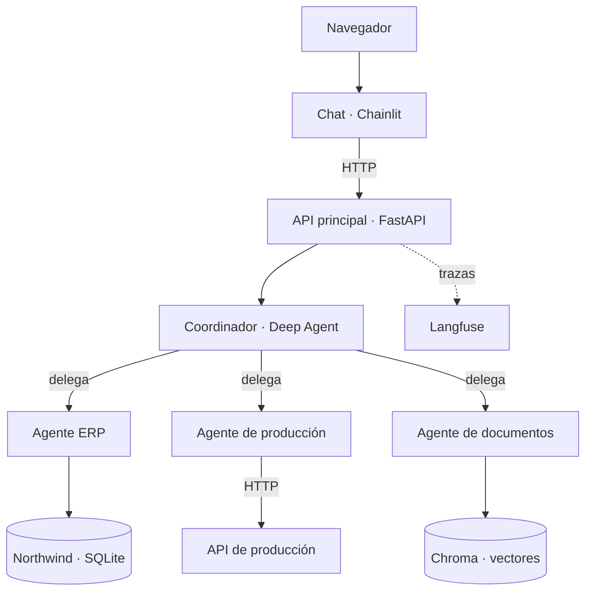

# Asistente de negocio multi-agente

Responde preguntas de negocio en lenguaje natural combinando tres fuentes de datos:

| Fuente         | Qué aporta                                 | Cómo se consulta                 |
| -------------- | ------------------------------------------ | -------------------------------- |
| **ERP**        | Clientes, pedidos e importes               | Base de datos Northwind (SQLite) |
| **Producción** | Estado de fabricación, bloqueos y retrasos | API REST                         |
| **Documentos** | Contratos y procedimientos en PDF          | RAG sobre una base vectorial     |

Un agente coordinador, construido con **Deep Agents de LangChain**, planifica la consulta, delega en un agente especializado por fuente y redacta una única respuesta. Cada respuesta indica **qué fuentes se han consultado y qué pasos se han ejecutado**.

---

## Puesta en marcha

Solo hace falta Docker (con Compose v2) y una clave de API de OpenAI, Azure OpenAI o Anthropic.

**1. Configura el modelo**

```bash
cp .env.example .env
```

Abre `.env` y rellena el bloque de tu proveedor:

```env
# OpenAI
MODEL=openai:gpt-5.6-luna
OPENAI_API_KEY=tu-clave
```

```env
# Azure OpenAI
MODEL=azure_openai:gpt-5.6-luna
AZURE_OPENAI_API_KEY=tu-clave
AZURE_OPENAI_BASE_URL=https://tu-recurso.openai.azure.com/
AZURE_OPENAI_API_VERSION=2024-12-01-preview
AZURE_OPENAI_MODEL_DEPLOYMENT_NAME=gpt-5.6-luna
```

**2. Arranca**

```bash
docker compose up -d --build
```

Un solo comando levanta todo: la aplicación y Langfuse. La primera vez tarda unos minutos (descarga de imágenes y dependencias) y necesita unos 4 GB de RAM. Al arrancar se preparan solos los datos del ERP, los de producción, dos PDF de ejemplo ya indexados y el usuario de Langfuse.

Comprueba que todo está en marcha con `docker compose ps`.

**3. Úsalo**

| Servicio                            | Dirección                  | Acceso                                 |
| ----------------------------------- | -------------------------- | -------------------------------------- |
| **Chat**                            | http://localhost:8080      |                                        |
| **API** (documentación interactiva) | http://localhost:8000/docs |                                        |
| Sistema de producción simulado      | http://localhost:8001/docs |                                        |
| **Langfuse** (trazas)               | http://localhost:3000      | `admin@example.com` / `langfuse-local` |

**Comandos útiles**

| Para...                                         | Comando                                                              |
| ----------------------------------------------- | -------------------------------------------------------------------- |
| Comprobar que el modelo responde                | `docker compose run --rm cli python scripts/check_model.py`          |
| Preguntar desde la terminal                     | `docker compose run --rm cli python scripts/ask.py "tu pregunta"`    |
| Ver las tablas y los pedidos del ERP            | `docker compose run --rm cli python scripts/inspect_data.py erp`     |
| Ver los fragmentos indexados y sus vectores     | `docker compose run --rm cli python scripts/inspect_data.py chroma`  |
| Ver los logs de la API (cada paso de la traza)  | `docker compose logs -f api`                                         |
| Lanzar los tests                                | `docker compose run --rm --build tests`                              |
| Parar                                           | `docker compose down` (con `-v` se borran también los datos)         |

---

## Observabilidad con Langfuse

Cada respuesta lleva su propia traza (`sources`, `reasoning`, `steps`), pensada para quien pregunta. [Langfuse](https://langfuse.com) añade la vista de quien opera el sistema: cada llamada al modelo y a cada herramienta, anidada por agente, con sus entradas, salidas, tokens y tiempos, y agrupada por conversación.

Se despliega junto a la aplicación, autoalojado y sin configuración manual: el usuario, el proyecto y sus claves de API se crean en el primer arranque, y la aplicación usa esas mismas claves. Entra en http://localhost:3000 con `admin@example.com` / `langfuse-local` y abre **Tracing** para ver cada consulta.

Cómo está montado:

- **`docker-compose.langfuse.yml`** define los servicios de Langfuse. Se suma al compose principal gracias a la línea `COMPOSE_FILE` de `.env`.
- **Para arrancar sin Langfuse** (ahorra unos 4 GB de RAM), comenta esa línea en `.env`. La aplicación funciona exactamente igual: solo deja de enviar trazas.
- **Usuario y contraseña** se cambian con `LANGFUSE_INIT_USER_EMAIL` y `LANGFUSE_INIT_USER_PASSWORD` en `.env`, antes del primer arranque.
- **Las contraseñas del archivo son para uso local.** Cambia todas las líneas marcadas con `CHANGEME` antes de exponerlo fuera de tu equipo.

---

## Ejemplos de uso

### Desde el chat

Abre http://localhost:8080 y pregunta. Algunas preguntas que resuelve:

- _¿Qué pedidos pendientes tiene el cliente Ernst Handel y en qué estado de producción están?_
- _¿Qué pedidos están bloqueados y cuál es el motivo?_
- _¿Qué clientes tienen pedidos retrasados por problemas de producción?_
- _Dame un resumen del estado de los pedidos de este mes._
- _¿Hay alguna penalización por retrasos en el contrato?_

Admite preguntas encadenadas (_"¿y cuáles de esos están bloqueados?"_, _"¿cuál es el impacto económico de esos?"_). Para añadir un documento, adjunta un PDF con el clip.

### Desde la API

```bash
curl -X POST http://localhost:8000/api/query \
  -H "Content-Type: application/json" \
  -d '{"question": "¿Qué pedidos están bloqueados y cuál es el motivo?", "session_id": "demo"}'
```

Respuesta real del sistema (GPT-5.6 Luna):

```json
{
  "answer": "Los pedidos bloqueados son:\n\n- **11039**: Falta de materia prima; proveedor sin stock.\n- **11054**: Retenido por riesgo de crédito del cliente.\n- **11062**: Falta de materia prima; proveedor sin stock.\n- **11071**: Incidencia de calidad; lote retenido para inspección.\n- **11075**: Incidencia de calidad; lote retenido para inspección.",
  "sources": ["Producción"],
  "reasoning": [
    "Coordinador: delega en el agente de producción → «Consulta el sistema de producción y devuelve todos los pedidos actualmente bloqueados...»",
    "Agente de producción: lista en producción los pedidos en estado «bloqueado» → 5 (11039, 11054, 11062, 11071, 11075)",
    "Coordinador: redacta la respuesta con los datos de Producción"
  ],
  "session_id": "demo"
}
```

Incluye además `steps` (el detalle de cada llamada a una herramienta) y `duration_ms`. `session_id` es opcional: repitiendo el mismo valor, el sistema recuerda la conversación.

Para subir un documento:

```bash
curl -X POST http://localhost:8000/api/documents -F "file=@contrato.pdf"
```

---

## Arquitectura



**Cómo se resuelve una pregunta**

1. El **coordinador** escribe un plan y reparte el trabajo. No tiene acceso a ningún dato: solo puede delegar.
2. Cada **agente especializado** recibe su encargo, usa sus herramientas y devuelve una respuesta breve.
3. El coordinador **cruza los resultados** (ERP y producción se unen por el número de pedido) y redacta la respuesta.
4. Mientras tanto, el sistema **registra cada llamada a una herramienta**. De ese registro salen `sources` y `reasoning`.

**Organización del código**

| Carpeta                         | Responsabilidad                                              |
| ------------------------------- | ------------------------------------------------------------ |
| `app/data_sources/`, `app/rag/` | Hablar con cada fuente: SQL, HTTP y búsqueda vectorial       |
| `app/tools/`                    | Las herramientas que pueden usar los agentes                 |
| `app/agents/`                   | Coordinador, agentes especializados, instrucciones y memoria |
| `app/services/`                 | Ejecutar una consulta y construir la trazabilidad            |
| `app/api/`                      | Endpoints HTTP                                               |
| `ui/`                           | Interfaz de chat                                             |
| `production_api/`               | Sistema de producción simulado (servicio independiente)      |

Añadir una fuente nueva consiste en escribir sus herramientas y declarar un agente más en `app/agents/subagents.py`. El resto del sistema no cambia.

---

## Decisiones técnicas

**La trazabilidad la genera el código, no el modelo.**
`sources` y `reasoning` se construyen a partir de las llamadas reales a las herramientas. Una fuente solo aparece si se ha consultado con éxito, y cada paso incluye los datos usados. El modelo no puede atribuirse una consulta que no ha hecho. Todo queda además en los logs.

**El coordinador no accede a los datos.**
Solo planifica y delega. Esto garantiza un diseño multi-agente real y mantiene pequeño el contexto de cada agente.

**El modelo no escribe SQL.**
Las consultas al ERP son fijas y parametrizadas, y la base se abre en solo lectura. Se evita la inyección de SQL y el comportamiento es predecible.

**El sistema de producción se simula como un servicio aparte.**
El enunciado no lo proporciona, así que se ha creado una API independiente a la que la aplicación solo accede por HTTP, como haría con un sistema real. Sus datos se generan a partir de los pedidos del ERP y son siempre los mismos, lo que permite comprobar las respuestas a mano.

**Las fechas de Northwind se actualizan.**
Los pedidos originales son de 1996 a 1998, y "los pedidos de este mes" no devolvería nada. Al arrancar se desplazan todas las fechas por igual para que el último pedido sea de hoy; los plazos y retrasos se conservan.

**Los documentos no salen de la máquina.**
Los embeddings se calculan con un modelo local, sin coste ni clave. Al proveedor del modelo de lenguaje solo llegan los fragmentos necesarios para responder.

**Las respuestas sobre documentos citan su origen.**
Cada fragmento guarda documento y página. Si ningún fragmento es suficientemente relevante, el sistema dice que los documentos no lo recogen en lugar de improvisar.

**Ejecución acotada.**
Cada agente tiene un máximo de llamadas a herramientas por consulta (`AGENT_MAX_TOOL_CALLS`, 10 por encargo de un subagente; `COORDINATOR_MAX_TOOL_CALLS`, 8), aplicado con el middleware de límites de LangChain. Superado el máximo, las llamadas dejan de ejecutarse y el agente responde con lo que tiene, de modo que una pregunta demasiado amplia no se convierte en minutos de llamadas. Las preguntas amplias se resuelven con herramientas agregadas (por ejemplo, todos los clientes con su número de pedidos en una sola consulta).

**Memoria por conversación.**
Se guarda el historial de cada `session_id` y se envían al modelo la pregunta actual y las cinco interacciones anteriores.

**El proveedor del modelo es intercambiable.**
Se elige con la variable `MODEL` (OpenAI, Azure OpenAI, Anthropic, Ollama), sin tocar el código. La temperatura solo se envía si se define `MODEL_TEMPERATURE`, porque los modelos de razonamiento como GPT-5.6 Luna usan la suya.

**Dos niveles de trazabilidad.**
La traza de cada respuesta (`sources`, `reasoning`) la construye la aplicación y está siempre presente, así que se puede mostrar al usuario final. Langfuse es una capa opcional para quien opera el sistema: depuración y seguimiento. Se conecta como un callback de LangChain, se desactiva sin cambiar código y nunca afecta a que una consulta funcione.

---

## Tests

```bash
docker compose run --rm --build tests
```

103 tests que **no necesitan clave de API**. Los agentes se prueban con un modelo simulado que sigue un guion; todo lo demás (delegación, herramientas, trazabilidad, memoria, límites, configuración del modelo, integración con Langfuse y API) es el código real.

---

## Dependencias

Python 3.12, con las dependencias fijadas en `pyproject.toml` y `uv.lock`.

| Para qué         | Librerías                                                            |
| ---------------- | -------------------------------------------------------------------- |
| Agentes          | `deepagents`, `langchain`, `langgraph`                               |
| Modelos          | `langchain-openai`, `langchain-anthropic`, `langchain-ollama`        |
| Documentos (RAG) | `langchain-chroma`, `fastembed`, `langchain-text-splitters`, `pypdf` |
| API              | `fastapi`, `uvicorn`, `httpx`                                        |
| Interfaz         | `chainlit`                                                           |
| Observabilidad   | `langfuse`                                                           |
| Tests            | `pytest`                                                             |

---

## Limitaciones conocidas

- **La memoria se pierde al reiniciar la API.** Para conservarla bastaría con cambiar el almacén de memoria por uno persistente.
- **La API no tiene autenticación.** En un entorno real iría protegida y con los documentos separados por usuario.
- **La búsqueda en documentos es mejorable.** El modelo de embeddings es pequeño; con preguntas formuladas de forma muy distinta al texto puede no encontrar el fragmento exacto.
- **No se leen PDF escaneados** (no hay OCR): se rechazan con un aviso.

---

## Datos

- **Northwind**: versión para SQLite de [jpwhite3/northwind-SQLite3](https://github.com/jpwhite3/northwind-SQLite3) (licencia MIT).
- Los datos de producción y los PDF de `data/docs/` son **ficticios**, creados para esta demostración.
